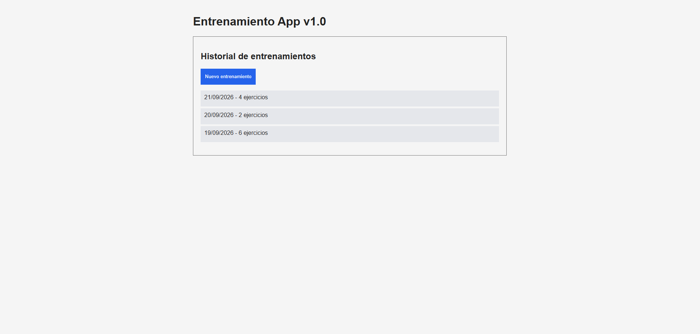
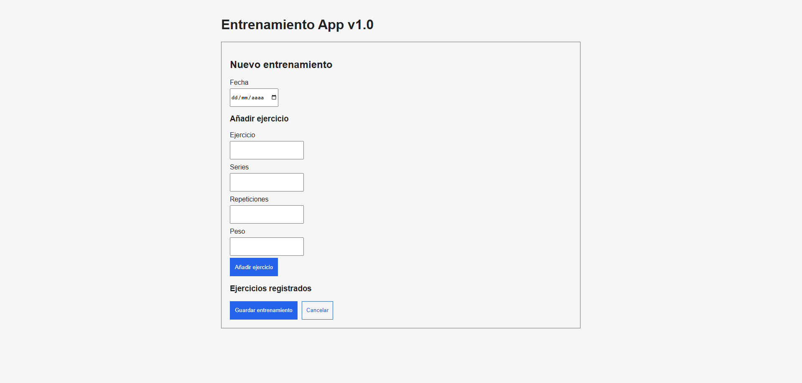
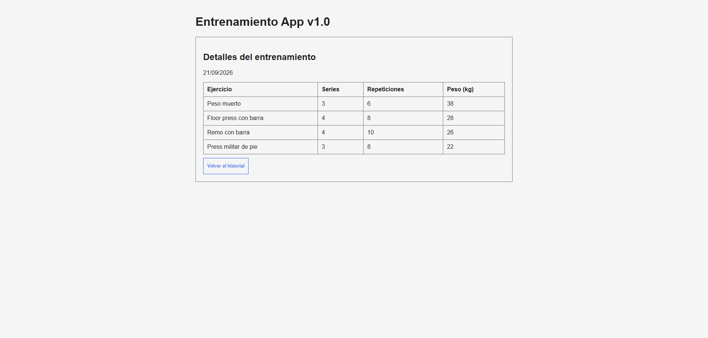

# Entrenamiento App v1.0

Aplicación web para registrar y consultar entrenamientos de fuerza.

**[▶️ Ver demo](https://albesandicode.github.io/entrenamiento-app/)**

### Historial de entrenamientos

### Nuevo entrenamiento

### Detalle del entrenamiento

## Descripción

Proyecto personal desarrollado como parte de mi vuelta a la programación y de mi preparación para trabajar como desarrollador Full-Stack junior.

Esta V1 permite registrar entrenamientos, añadir ejercicios y consultar el historial y el detalle de cada entrenamiento.

El objetivo de esta versión es consolidar fundamentos de HTML, CSS y JavaScript mediante un proyecto real y funcional, sin introducir todavía un backend, un framework o una base de datos.

## Características

- Registro de entrenamientos de fuerza.
- Añadir varios ejercicios antes de guardar un entrenamiento.
- Consulta del historial de entrenamientos ordenado por fecha.
- Vista detallada de cada entrenamiento con sus ejercicios, series, repeticiones y peso.
- Navegación entre las diferentes vistas de la aplicación.
- Interfaz responsive y adaptada a dispositivos móviles.
- Control que impide guardar un entrenamiento sin ejercicios.

## Tecnologías utilizadas

- HTML5
- CSS3
- JavaScript **Vanilla**, sin librerías ni frameworks.
- Git
- GitHub Pages

## Cómo usarla

1. Accede a la [demo](https://albesandicode.github.io/entrenamiento-app/).
2. Pulsa **Nuevo entrenamiento**.
3. Selecciona la fecha.
4. Añade los ejercicios indicando series, repeticiones y peso.
5. Guarda el entrenamiento.
6. Consulta el entrenamiento desde el historial para ver su detalle.

## Limitaciones de la V1

Esta versión tiene un alcance limitado de forma intencionada.

- Los entrenamientos se mantienen únicamente en memoria durante la sesión. Si se recarga la página, los datos introducidos durante esa sesión se pierden.
- No se validan los campos vacíos ni se comprueba que los campos numéricos contengan realmente números.
- No hay autenticación ni cuentas de usuario.
- La aplicación está planteada para un único usuario y no permite compartir datos entre usuarios.

## Qué he aprendido

Durante el desarrollo he tenido que resolver varios problemas que me han ayudado a entender mejor cómo funcionan los datos y el código:

- **Referencias a arrays:** descubrí que todos los entrenamientos estaban compartiendo el mismo array de ejercicios. Lo solucioné creando un nuevo array con `currentWorkoutExercises = []` cuando correspondía iniciar un entrenamiento nuevo.
- **Renderizado dinámico:** entendí que generar el historial no significa que la interfaz se actualice automáticamente. Creé una función de renderizado que se ejecuta tanto al cargar la aplicación como después de guardar un entrenamiento.
- **Depuración:** aprendí a seguir el valor de las variables durante la ejecución y a identificar errores como `ReferenceError` y valores `undefined`, en lugar de limitarme a modificar código hasta que funcionase.
- **Estado de la interfaz:** aprendí a distinguir entre los datos almacenados en JavaScript, los elementos del DOM y el texto que se genera para mostrarlos.

## Próximos pasos

- Migrar el frontend a Angular.
- Incorporar un backend con Spring Boot y una base de datos.
- Añadir autenticación para que cada usuario pueda gestionar sus propios entrenamientos.
- Mejorar progresivamente la interfaz y añadir nuevas funcionalidades a partir del uso de la aplicación.